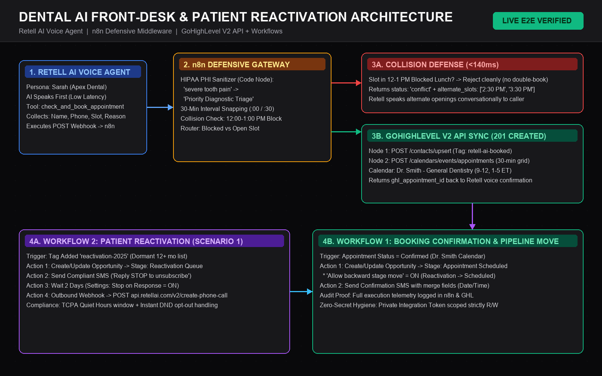

# Apex Dental AI Front-Desk & Patient Reactivation Engine



> **Practice Build (Sample Dental Clinic: Apex Dental Care)**  
> **Stack:** Retell AI + n8n Cloud + GoHighLevel V2 API & Workflows

An end-to-end dental front-desk voice receptionist and dormant patient reactivation system engineered around real-world production failure modes: **blocked calendar collision defense**, **30-minute interval enforcement**, **HIPAA non-PHI data sanitization**, and **TCPA-compliant opt-out automation**.

---

## 🏗️ Architecture Overview

1. **Retell AI Voice Receptionist (`prompts/retell_sarah_dental_prompt.md`):**
   - Greets callers immediately (`AI speaks first`) and collects name, phone, desired slot, and visit reason.
   - Invokes `check_and_book_appointment` (`prompts/retell_tool_schema.json`) over HTTP POST to n8n.
2. **n8n Defensive Booking Middleware (`workflows/n8n_dental_defensive_middleware.json`):**
   - **HIPAA Sanitizer (Code Node):** Maps spoken patient symptoms (`"severe tooth pain"`, `"routine cleaning"`) into standardized non-PHI service categories (`Priority Diagnostic Triage`, `Routine Dental Hygiene & Cleaning`) before CRM ingestion.
   - **30-Minute Interval Snapping:** Normalizes off-grid requests (e.g., `10:15 AM` → `10:00 AM`) to prevent GoHighLevel 400 validation errors.
   - **Collision Detection (`<140ms`):** Rejects requests inside Dr. Smith's blocked `12:00 PM – 1:00 PM ET` lunch block and returns valid alternate slots conversationally.
   - **Live GoHighLevel V2 Sync (`~1.6s`):** Upserts contacts via `POST /contacts/upsert` (tagged `retell-ai-booked`) and creates confirmed appointments via `POST /calendars/events/appointments`.
3. **GoHighLevel CRM & Workflows (`docs/ghl_workflows_blueprint.md`):**
   - **Workflow 1 (`Dental Booking Confirmation`):** Automatically moves opportunities (including backward moves from `Reactivation Queue` → `Appointment Scheduled`) and fires confirmation SMS.
   - **Workflow 2 (`Patient Reactivation Campaign`):** Targets dormant contacts (`reactivation-2025`), enforces TCPA quiet hours + `"Reply STOP to unsubscribe"`, waits 2 days with `Stop on response` enabled, and escalates non-responders to Retell Outbound API.

---

## 📁 Repository Structure

```text
├── README.md
├── DEBUG_CASE_STUDIES.md
├── workflows/
│   └── n8n_dental_defensive_middleware.json   # Sanitized 7-node n8n blueprint
├── prompts/
│   ├── retell_sarah_dental_prompt.md          # Voice receptionist prompt & settings
│   └── retell_tool_schema.json                # Custom function definition
├── docs/
│   └── ghl_workflows_blueprint.md             # Calendar, Pipeline & GHL Workflow specs
└── screenshots/                               # 15 verified build, debug & live proof captures
```

---

## 🔐 Setup & Secret Hygiene

1. Import `workflows/n8n_dental_defensive_middleware.json` into n8n.
2. Replace placeholders inside the two GoHighLevel HTTP Request nodes with your own credentials (never commit raw tokens):
   - `YOUR_GHL_PRIVATE_INTEGRATION_TOKEN` (requires `contacts.readonly/write`, `calendars.readonly/write`, `calendars/events.readonly/write`)
   - `YOUR_GHL_LOCATION_ID` & `YOUR_GHL_CALENDAR_ID`
3. Bind your published n8n webhook URL inside Retell AI's custom function tool (`prompts/retell_tool_schema.json`).

---

## 🔬 Verified Execution Telemetry

- **Live Voice Booking (`ID#66`):** `1.588s` end-to-end from Retell web call to GoHighLevel Contact + Appointment creation.
- **Collision Defense (`ID#54`):** `<140ms` rejection of 12:30 PM blocked slot with alternate slot suggestions.
- **Troubleshooting Log:** See [`DEBUG_CASE_STUDIES.md`](./DEBUG_CASE_STUDIES.md) for root cause breakdowns of HTTP 500 AST syntax errors, HTTP 401 OAuth scopes, and HTTP 400 interval boundaries.
